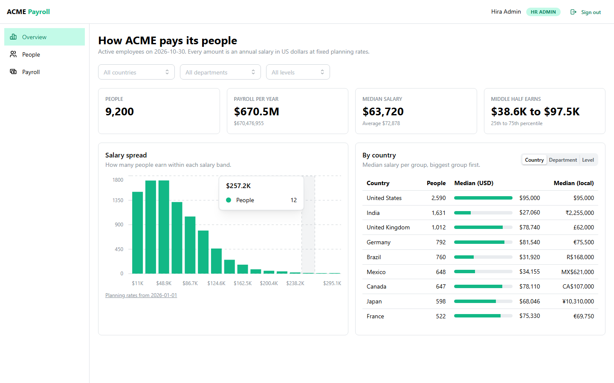
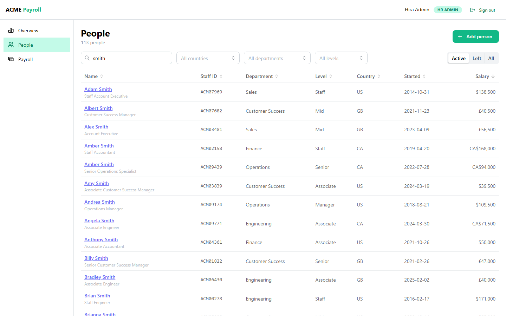
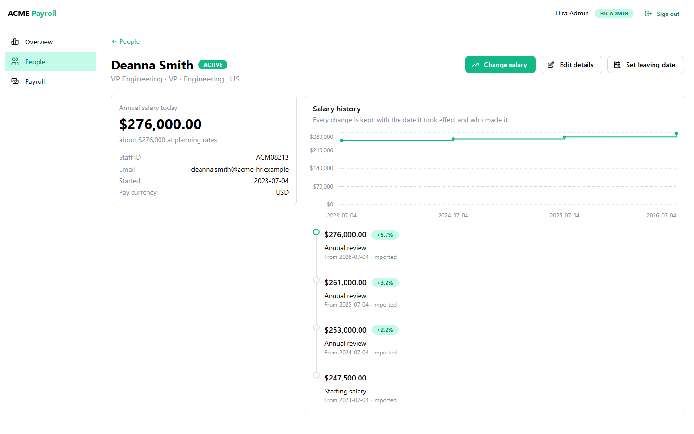

# ACME Payroll

Salary management for the HR Manager of ACME: 10,000 employees in nine countries, until now
managed in spreadsheets. The app keeps every employee's pay with a full history of changes,
shows how the company pays people in one currency, runs a monthly payroll record, and
separates HR admins (who change things) from viewers (who only look).

| | |
|---|---|
| **Live app** | _add after deploying (see [docs/deployment.md](docs/deployment.md))_ |
| **API docs** | _add `https://<api>/api/docs` after deploying_ |
| **Demo video** | _add link_ |
| **Sign in** | `hr.admin@acme-hr.example` (HR admin) or `hr.viewer@acme-hr.example` (viewer), password `acme-payroll-demo` |



## Documents

| | |
|---|---|
| [docs/requirements.md](docs/requirements.md) | What is being built and what is deliberately left out, written before any code |
| [docs/design.md](docs/design.md) | Architecture, data model, and the reasoning behind each decision (with diagrams) |
| [docs/performance.md](docs/performance.md) | Timings on 10,000 employees and the choices behind them |
| [docs/ai-usage.md](docs/ai-usage.md) | How AI tools were used, the prompts, and what was checked or corrected |
| [docs/deployment.md](docs/deployment.md) | Deploying on free plans (Vercel + Neon) |

## What it does

- **Overview.** Headcount, payroll, median and spread in USD; salary distribution; median by
  country, department or level, with local-currency medians per country.
- **People.** Search, filter and sort 10,000 people (salary sorted in USD). Each profile shows
  current pay, a chart and a timeline of every change with who made it.
- **Salary changes.** Always a new dated entry, never an overwrite. Rules: no future dates,
  nothing before the start date or the last change, a listed reason.
- **Payroll.** One run per month, prorated by days employed for joiners and leavers, frozen
  once created.
- **Roles.** Admins change data; viewers read. Enforced by the API.

| | |
|---|---|
|  |  |

## Stack

| | |
|---|---|
| Backend | Python 3.11+, FastAPI, SQLAlchemy 2, Alembic, PostgreSQL (psycopg 3) |
| Frontend | Next.js 16 (TypeScript), Mantine 9, TanStack Query |
| Tests | pytest on real PostgreSQL (111), Vitest + Testing Library (17) |
| CI | GitHub Actions: lint, types, both test suites, migration check, production build |

## Run locally

Needs Docker (for PostgreSQL), Python 3.11+ and Node 20+.

```bash
docker compose up -d db                  # PostgreSQL on localhost:55433

cd backend
python -m venv .venv && .venv/Scripts/activate      # macOS/Linux: source .venv/bin/activate
pip install -e ".[dev]"
alembic upgrade head
python -m app.seed                       # 10,000 employees in a few seconds
uvicorn app.main:create_app --factory --port 8050 --reload

cd ../frontend                           # second terminal
npm install
cp .env.example .env.local               # API_ORIGIN=http://localhost:8050
npm run dev -- -p 3050                   # http://localhost:3050
```

## Tests

```bash
cd backend && pytest          # needs the database from docker compose; ~15 s
cd frontend && npm test
```

## Layout

```
backend/   FastAPI app, one folder per feature (auth, employees, compensation,
           analytics, payroll, seed), Alembic migrations, tests
frontend/  Next.js app: app/ routes, components/, lib/ (API client, money, queries)
docs/      requirements, design, performance, AI usage, deployment, screenshots
```
