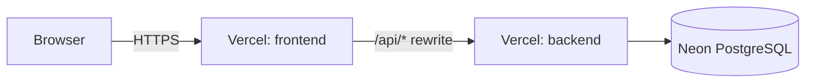

# Deployment

Free plans, no payment card:

| Piece | Where | Root directory |
|---|---|---|
| Frontend | Vercel project | `frontend` |
| Backend | Vercel project (Python runtime, entry `backend/index.py`) | `backend` |
| Database | Neon free PostgreSQL | |



Because the frontend proxies `/api/*`, the browser sees a single site. The session cookie is
first-party and the backend needs no CORS settings.

## 1. Database (Neon)

1. Create a project at [neon.tech](https://neon.tech), region close to Vercel's default
   (AWS US East).
2. **Connect**, then copy the **pooled** connection string.
3. Create the tables and load the demo data from your machine:

```bash
cd backend
export PAYROLL_DATABASE_URL="postgresql://..."     # PowerShell: $env:PAYROLL_DATABASE_URL="..."
alembic upgrade head
python -m app.seed
```

## 2. Backend (Vercel)

New project, import the repository, **Root Directory** `backend`. Environment variables:

| Name | Value |
|---|---|
| `PAYROLL_ENV` | `prod` |
| `PAYROLL_DATABASE_URL` | the Neon pooled connection string |
| `PAYROLL_SECRET_KEY` | 40+ random characters: `python -c "import secrets; print(secrets.token_urlsafe(40))"` |

Deploy, then check `https://<backend>/api/health` returns `{"status":"ok"}`.

## 3. Frontend (Vercel)

New project from the same repository, **Root Directory** `frontend`. One variable:

| Name | Value |
|---|---|
| `API_ORIGIN` | the backend URL from step 2, no trailing slash |

Deploy and sign in at the frontend URL.

## Reset the demo data

```bash
PAYROLL_DATABASE_URL="postgresql://..." python -m app.seed --reset
```

## Troubleshooting

| Symptom | Fix |
|---|---|
| Sign-in fails with "Request failed (500)" | Check `API_ORIGIN` on the frontend and that the backend's `/api/health` works |
| Backend fails to start mentioning the secret | Set `PAYROLL_SECRET_KEY` to 32+ characters |
| Every API call returns 500 | Check `PAYROLL_DATABASE_URL`, and that `alembic upgrade head` ran against it |
