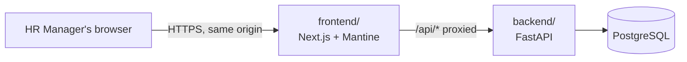
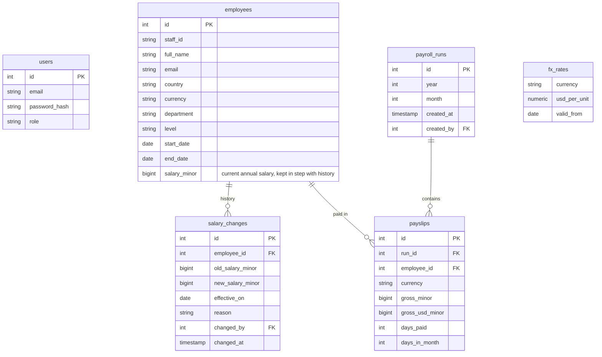

# Design

How the app in [requirements.md](requirements.md) is put together, and why.

## Shape



The browser only ever talks to the frontend's own domain. Next.js forwards `/api/*` to the
backend. That keeps the session cookie first-party and means the backend needs no CORS
setup at all.

## Backend: one folder per feature

```
backend/app/
  core/          settings, database session, money helpers, errors
  auth/          users, password hashing, session cookie, role checks
  employees/     employee records, directory search
  compensation/  salary changes and history
  analytics/     pay statistics (SQL)
  payroll/       monthly runs and payslips
  seed/          10,000 deterministic employees
```

Each feature folder holds its own `models.py`, `schemas.py`, `service.py` and `router.py`.
A change to payroll stays inside `payroll/`. Rules that need no database (proration,
money conversion) are plain functions with their own unit tests.

## Data model



## Decisions

**Money is an integer of the smallest unit.** `salary_minor` is cents, pence or whole yen.
Each currency knows its decimal places (JPY has none). Exchange rates are `NUMERIC` and
conversions round once at the end.

**Current salary on the employee, history beside it.** A salary change writes a
`salary_changes` row and updates `employees.salary_minor` in the same transaction. Reads
(the directory, analytics) never have to work out "latest change" per person, which keeps
10,000-row queries simple and fast. The cost is two writes per change, done in one place
(`compensation/service.py`) and covered by tests. Changes take effect today or earlier;
future-dated raises are out of scope, which is what keeps "current" always correct.

**Analytics in SQL.** Postgres has `percentile_cont`, so median and quartiles are computed
in the database, after joining each employee to the exchange rate for their currency. One
query per screen, no rows pulled into Python.

**Payroll is prorated.** Someone who joins on the 20th or leaves on the 10th is paid for
the days they were employed that month: `annual / 12 × days_employed / days_in_month`,
rounded once. A run copies the amounts into payslips, so later salary changes never alter
it. One run per month.

**Sessions are an httpOnly cookie.** Login sets a signed, httpOnly, `SameSite=Lax` cookie.
JavaScript never sees the token, so a script injected into the page cannot steal it. The
same-origin proxy above is what makes this work across two deployments.

**Roles are checked in the backend.** `admin` can change data; `viewer` can only read.
Every write route declares the role it needs. Hiding buttons in the UI is a convenience,
not the protection.

**PostgreSQL everywhere, including tests.** Tests run against a real Postgres (a local
container, a service in CI), so what is tested is what runs in production, percentiles
included. Each test runs inside a transaction that is rolled back, so tests stay fast and
independent.

**Fixed, dated exchange rates.** Seeded once, effective from a date. Reports are
repeatable.

## Testing

| Level | What | How |
|---|---|---|
| Rules | proration, money, salary-change validation | plain pytest, no database |
| API | every route, roles, error responses | FastAPI test client, Postgres, rollback per test |
| Frontend | formatting, forms, tables | Vitest + Testing Library |
